# github-readme

A calm, animated stats card for your GitHub profile README. It is regenerated every day by GitHub Actions and
comes in a light and a dark version.

<picture>
  <source media="(prefers-color-scheme: dark)" srcset="https://raw.githubusercontent.com/igorovh/github-readme/generated/profile-dark.svg">
  
</picture>

It shows:

- **GitHub:** contributions, commits, pull requests, code reviews, stars, repositories and languages. Only repos
  owned by you or your organizations are counted, including private ones if you want.
- **AI usage** (optional): tokens, spend, active days, streak, leaderboard rank, top models and a daily heatmap
  from [tokenmaxxing.sh](https://tokenmaxxing.sh).
- Your avatar, name and a short bio.

## Setup

1. **Create your copy.** Click **Use this template** → **Create a new repository**. Keep the name `github-readme`
   or pick another one and use it in the links below.
2. **Create a token.** Go to [Settings → Developer settings → Personal access tokens (classic)](https://github.com/settings/tokens/new?scopes=repo,read:org,read:user&description=github-readme)
   and create a token with these scopes:
   - `repo`: read private repos and private contributions,
   - `read:org`: find your organizations and their private repos,
   - `read:user`: read your profile.

   Set the expiration to what you are comfortable with. When it expires, the daily run fails until you add a new one.
3. **Add the token as a secret.** In your copy go to **Settings → Secrets and variables → Actions → New repository
   secret**, name it `ACCESS_TOKEN` and paste the token.
4. **Edit [`config.json`](config.json)** (see [Configuration](#configuration)). Committing it starts a run.
5. **Run it.** Open **Actions → Generate images → Run workflow** if it did not start on its own. After about
   30 seconds the images are on the `generated` branch.
6. **Add it to your profile.** Paste this into the `README.md` of your `<username>/<username>` repo and replace
   `USERNAME`:

   ```html
   <picture>
     <source media="(prefers-color-scheme: dark)" srcset="https://raw.githubusercontent.com/USERNAME/github-readme/generated/profile-dark.svg">
     
   </picture>
   ```

   SVG images on GitHub cannot contain links, so put clickable links below it, for example:

   ```html
   <p align="center">
     <a href="https://example.com">example.com</a> &nbsp;·&nbsp; <a href="mailto:you@example.com">you@example.com</a>
   </p>
   ```

The images update every day at 03:17 UTC, and whenever you change `config.json`.

## Configuration

All keys are optional.

| Key                | Default     | What it does                                                                                                   |
| ------------------ | ----------- | -------------------------------------------------------------------------------------------------------------- |
| `name`             | GitHub name | Name in the title.                                                                                             |
| `greeting`         | `"hi, i’m"` | Text before the name.                                                                                          |
| `bio`              | `[]`        | Lines under the title. Wrap words in `**double asterisks**` to make them bold.                                 |
| `owners`           | `"auto"`    | Whose repos count. `"auto"` means you and every organization you belong to. Or a list: `["you", "your-org"]`. |
| `includePrivate`   | `true`      | Count private repos and private contributions.                                                                 |
| `excludeRepos`     | `[]`        | Repos to skip. `*` matches anything: `["you/dotfiles", "your-org/*-archive"]`.                                 |
| `excludeLanguages` | `[]`        | Languages to skip, case insensitive: `["HTML", "Jupyter Notebook"]`.                                           |
| `languages`        | `7`         | How many languages to list (1–7). The rest is grouped as "Other".                                              |
| `tokenmaxxing`     | `null`      | Your [tokenmaxxing.sh](https://tokenmaxxing.sh) username. Leave `null` to hide the AI sections.                |
| `models`           | `5`         | How many AI models to list (1–5). The rest is grouped as "Other".                                              |

Example:

```json
{
  "name": "igor",
  "bio": ["developer, mostly typescript and java.", "building **Enhancer**, a browser extension for twitch and kick."],
  "owners": "auto",
  "includePrivate": true,
  "excludeRepos": ["igorovh/github-readme"],
  "tokenmaxxing": "igorovh"
}
```

## How the numbers are counted

- **Contributions** are commits, pull requests, issues, code reviews and created repositories, in repos whose owner is
  in `owners`. Work in other people's repos is left out on purpose, so the number is lower than the one on your
  GitHub profile.
- **Stars, repositories and languages** cover your own repos (forks excluded) plus organization repos you have
  contributed to.
- **Languages** are weighted by bytes of code, as GitHub reports them.
- GitHub lists at most 100 repos per year and contribution type, so very busy years may be slightly undercounted.

## Speed and caching

A run takes a few seconds:

- There is no `npm install`. Node 24 runs the TypeScript sources directly, with no dependencies.
- Independent requests run in parallel, and repo details are fetched in small parallel batches.
- Totals for finished years are cached in `cache.json` on the `generated` branch. The cache resets when you change
  `owners`, `includePrivate` or `excludeRepos`, and every 30 days.
- If tokenmaxxing is down, the run keeps the previous AI numbers instead of failing.
- The `generated` branch is force-pushed as a single commit, so it does not grow every day.

## Run it locally

```sh
ACCESS_TOKEN=$(gh auth token) node src/main.ts   # needs Node 22.18 or newer
```

The images are written to `out/`. Set `OUT_DIR` or `CONFIG` to change paths. For type checking, run `npm install`
and `npm run typecheck`.

## Credits and license

Based on the idea of [jstrieb/github-stats](https://github.com/jstrieb/github-stats): generate profile stats with
your own token in GitHub Actions, so private repos count too. This is a new implementation with a different design,
and it is licensed under the same [GPL-3.0](LICENSE) license.

AI usage data comes from the public API of [tokenmaxxing.sh](https://tokenmaxxing.sh). This project is not
affiliated with tokenmaxxing.sh or GitHub.
